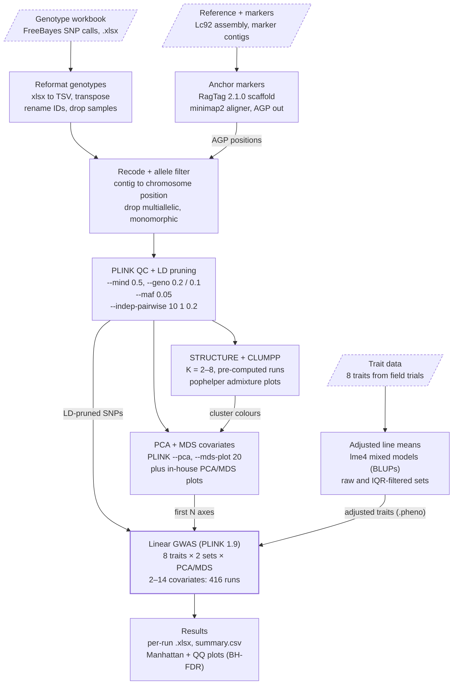

# SLU Lepidium campestre GWAS

This repository contains the Snakemake pipeline and all custom code for the SLU *Lepidium campestre* (field cress) genome-wide association study (GWAS).
The pipeline runs a GWAS on 8 seed-quality and agronomic traits using PLINK 1.9 linear models with 2 to 14 PCA or MDS covariates. It is implemented in Snakemake, with one pinned Conda environment per tool, and uses custom Python, R and bash code.

[](https://snakemake.github.io)
[](https://docs.conda.io/projects/conda/en/latest/user-guide/install/index.html)


Note: This repository only covers the code of the pipeline. Raw genotype, phenotype, genome and marker files are not included and must be placed under `data/` before running (see [Inputs](#required-inputs)).

## Contents

- [Overview](#overview)
- [Installation](#installation)
- [Running the pipeline](#running-the-pipeline)
- [Workflow stages](#workflow-stages)
- [Software and versions](#software-and-versions)
- [Custom scripts](#custom-scripts)
- [Key parameters and filtering thresholds](#key-parameters-and-filtering-thresholds)
- [Inputs and outputs](#inputs-and-outputs)
- [Directory structure](#directory-structure)
- [Notes and known issues](#notes-and-known-issues)
- [Authors](#authors)
- [License](#license)

## Overview

| Item | Value |
| --- | --- |
| Workflow manager | Snakemake 5.8.1, run with `--use-conda` |
| Size | 55 active rules plus `rule all`; 23 custom scripts (18 Python, 5 R); 10 Conda environments |
| Traits | erucic acid fraction, flowering time, glucoallyssin, total glucosinolate, oil content, oleic acid fraction, seed weight, sinalbin |
| GWAS runs | 416 = 2 phenotype sets × 8 traits × 2 covariate types × 13 covariate counts |
| Genotype source | Targeted SNP genotyping: Bowtie2 alignment, FreeBayes calling (ploidy 2, min count 8), NGS1763, 2020-06-12 (from the input file name) |
| Configuration | All paths and parameters are hard-coded in the Snakefile and scripts; there is no `config.yaml` |

## Installation

### Installing via Conda

To use this workflow, clone this repository and install [`conda`](https://docs.conda.io/projects/conda/en/latest/user-guide/install/index.html).

Create and activate a Conda environment for running Snakemake:

```bash
git clone https://github.com/felixseifert/slu-gwas-lepidium-campestre.git
cd slu-gwas-lepidium-campestre

# Create a new conda environment with Snakemake and its dependencies
conda env create -n snakemake -f workflow/envs/snakemake.yaml

# Activate the Snakemake conda environment
conda activate snakemake
```

All other tools are installed automatically by Snakemake from the environment files in `workflow/envs/` on the first run.

## Running the pipeline

With the Snakemake environment activated and the input files in place, run the pipeline from the repository root:

```bash
# Dry run: list the jobs without executing them
snakemake -n -s workflow/Snakefile

# Run the GWAS pipeline (adapt the number of cores to your machine)
snakemake --cores 32 --use-conda -s workflow/Snakefile
```

The GWAS and GWAS-plot rules request 32 threads and STRUCTURE 16; Snakemake caps them at `--cores`. Input and output paths resolve against the directory Snakemake is run in, while scripts are found via `workflow.basedir`.

On execution, the following directories are created in the working directory:

```
path/to/your/work_dir/
├── analysis/
│   ├── data/                   Reformatted input data
│   ├── genotype/               Genotype data of the various processing steps
│   ├── gwas/                   GWAS results for different filterings of the dataset and per phenotype
│   ├── marker_anchoring/       Results from anchoring of SNP markers to the reference genome
│   ├── phenotype/              Reformatted and adjusted phenotype data
│   ├── plots/                  Plots generated for the GWAS analysis
│   │   ├── gwas/                   Manhattan and QQ plots per dataset filtering and phenotype
│   │   ├── heatmaps/               Heatmaps of the genotype information at different filtering steps
│   │   ├── pca/ and mds/           PCA/MDS plots, also coloured by STRUCTURE populations of various K
│   │   ├── phenotype/              Distribution plots of adjusted phenotype values
│   │   └── population_structure/   Population structure plots of various K
│   └── population_structure/   Population structure results (PCA, MDS, STRUCTURE, CLUMPP)
├── benchmark/                  Benchmark files for the rules of the Snakemake pipeline
└── logs/                       Log files for the rules of the Snakemake pipeline
```

## Workflow stages

Three input streams (genotypes, traits, reference) converge on one PLINK linear GWAS, with population-structure axes supplied as covariates.



The genotype stream is the backbone: markers are anchored to chromosomes, filtered and LD-pruned before both the covariate analyses and the GWAS use them.

| # | Stage | Rules | Tools |
| --- | --- | --- | --- |
| 1 | Genotype reformatting | `export_genotype_data_from_xlsx`, `genotype_data_sample_title_trim`, `genotype_data_remove_unnecessary_columns`, `genotype_data_transpose`, `genotype_truncate_genotype_identifier`, `genotype_drop_samples` | Python, sed |
| 2 | Phenotype adjustment | `rename_trait_sample_identifier`, `calculate_adjusted_phenotype`, `calculate_adjusted_phenotype_without_outlier`, `generate_phenotype_distribution_plot`, `convert_adjusted_phenotype_to_plink_format` | R lme4, Python, awk |
| 3 | Marker anchoring | `marker_to_genome_scaffolding`, `clean_agp_file`, `genotype_data_assembly_recoding` | RagTag, Python |
| 4 | Allele filter and PLINK conversion | `genotype_marker_filtering`, `genotype_plink_text_input_conversion`, `genotype_plink_binary_conversion` | Python, PLINK |
| 5 | QC and LD pruning | `plink_filter_genotype_missing_nonstringent`, `plink_filter_marker_missing_nonstringent`, `plink_filter_genotype_missing`, `plink_filter_marker_missing`, `plink_filter_minor_allele_frequency`, `plink_prune_marker_set`, `plink_extract_pruned_marker_set` | PLINK |
| 6 | GWAS covariates | `plink_perform_pca`, `plink_perform_mds`, `reformat_mds_as_plink_covar` | PLINK, awk |
| 7 | Population structure and plots | `convert_binary_plink_to_additive_raw`, `redundancy_filter_plink_additive_raw`, `extract_genotype_data`, `perform_dimensionality_reduction_analysis`, `generate_dimensionality_reduction_plots`, `convert_binary_plink_to_structure_format`, `export_sample_labels`, `extract_structure_sample_names`, `structure_cluster_analysis` (disabled), `structure_replicate_clumpp_aggregation`, `structure_clumpp_analysis`, `structure_clumpp_pophelper_reformat`, `clumpp_pophelper_max_cluster_export`, `pophelper_plot_generation`, `generate_dimensionality_reduction_plots_cluster_color` | PLINK, Python, STRUCTURE, CLUMPP, pophelper |
| 8 | GWAS | `plink_gwas_linear_analysis` | PLINK |
| 9 | GWAS reporting | `gwas_ref_output`, `gwas_summary_listing_output`, `gwas_covar_plots` | R writexl, Python, R qqman |
| 10 | QC summaries and heatmaps | `plink_missingness_summary`, `plink_missingness_summary_reformat`, `plink_marker_allele_frequency_summary`, `plink_marker_allele_frequency_summary_reformat`, `convert_unfiltered_binary_plink_to_additive_raw`, `convert_filtered_binary_plink_to_additive_raw`, 4 × `generate_*_plink_additive_cluster_heatmap_plot` | PLINK, awk, Python seaborn |

## Software and versions

Every tool is pinned in one of 10 Conda files under `workflow/envs/`; Snakemake builds each environment on first run with `--use-conda`. Versions below are exactly as pinned in the repository.

### Bioinformatics tools

| Tool | Version | Environment | Used for |
| --- | --- | --- | --- |
| [Snakemake](https://snakemake.github.io) | 5.8.1 | `snakemake.yaml` | Workflow engine (with conda 23.3.1, natsort 8.3.1) |
| [PLINK](https://www.cog-genomics.org/plink/1.9/) | 1.90b6.12 | `plink.yaml` | Format conversion, missingness/MAF filters, LD pruning, PCA, MDS, linear GWAS, summary stats |
| [RagTag](https://github.com/malonge/RagTag) | 2.1.0 | `ragtag.yaml` | Anchors marker contigs to the Lc92 reference assembly (`scaffold`, minimap2 aligner) |
| minimap2 | not pinned | `ragtag.yaml` (dependency) | Aligner called by RagTag; version is whatever Conda resolves |
| [STRUCTURE](https://web.stanford.edu/group/pritchardlab/structure.html) | 2.3.4 | `structure.yaml` | Bayesian population-structure clustering, K = 2–8 |
| [structure_threader](https://structure-threader.readthedocs.io) | 1.3.11 (pip) | `structure.yaml` | Parallel STRUCTURE runs (with pip 24.0) |
| [CLUMPP](https://rosenberglab.stanford.edu/clumpp.html) | 1.1.2 | `clumpp.yaml` | Aligns STRUCTURE replicate runs per K |
| [pophelper](https://github.com/royfrancis/pophelper) (R) | 2.3.1 | `pophelper.yaml` | Admixture bar plots of CLUMPP results |

### Python packages (`python3.yaml`)

| Package | Version | Used for |
| --- | --- | --- |
| python | 3.9.18 | Runtime for all 18 Python scripts |
| pandas | 1.4.4 | Table I/O and reshaping in every script |
| numpy | 1.26.0 | Numerics, MDS eigendecomposition |
| scikit-learn | 1.3.0 | `StandardScaler` + `PCA` for the in-house PCA |
| matplotlib | 3.8.0 | 2D, 3D, matrix, scree and cumulative-variance plots |
| seaborn | 0.12.2 | Trait distribution plots, clustered genotype heatmaps |
| scipy | 1.11.3 | Hierarchical clustering backend for `seaborn.clustermap` |
| fastcluster | 1.2.6 | Faster linkage for `clustermap`, picked up automatically |
| ffmpeg | 4.2.2 | Encodes 3D-rotation MP4 animations (libx264) |
| openpyxl | 3.0.10 | Reads the raw genotype workbook and per-run GWAS `.xlsx` files |
| xlrd | 1.2.0 | Legacy Excel reader; not needed for `.xlsx` with pandas 1.4 |
| biopython | 1.78 | Declared but not imported by any script |
| scikit-bio | 0.5.6 | Declared but not imported by any script |

Channels: anaconda, conda-forge, bioconda, defaults.

### R packages

| Package | Version | Environment | Used for |
| --- | --- | --- | --- |
| r-lme4 | 1.1-32 | `r_lme4.yaml` | Mixed models for adjusted line means (BLUPs) |
| r-matrix | 1.6.3 | `r_lme4.yaml` | lme4 dependency |
| r-dplyr | 1.1.2 / 1.1.4 | `r_lme4.yaml` / `r_qqman.yaml`, `r_xlsx.yaml` | Data wrangling in GWAS summary and plot scripts |
| r-base | 4.3.3 | `r_qqman.yaml`, `r_xlsx.yaml` | R runtime (`r_lme4.yaml` leaves R unpinned) |
| r-base | 4.3.2 | `pophelper.yaml` | R runtime for pophelper |
| r-qqman | 0.1.9 | `r_qqman.yaml` | Manhattan and QQ plots |
| r-writexl | 1.5.0 | `r_xlsx.yaml` | Writes per-run GWAS result workbooks |
| r-purrr | 1.0.2 | `r_xlsx.yaml` | Splits unanchored marker IDs into positions |
| r-stringr | 1.5.1 / 1.5.0 | `r_qqman.yaml`, `r_xlsx.yaml` / `pophelper.yaml` | String handling (LG prefixes, file lists) |
| r-argparse | 2.2.2 / 2.2.3 | `r_qqman.yaml` / `r_xlsx.yaml` | Command-line parsing in `gwas_plots.R`, `gwas_summary.R` |
| r-optparse | 1.7.3 | `pophelper.yaml` | Command-line parsing in `generate_pophelper_plots.R` |
| r-janitor | 2.2.0 | `r_qqman.yaml` | Declared but not used |

### Unpinned system tools

Rules without a `conda:` directive use the host's bash, GNU `sed`, `awk`, `cut`, `grep`, `tail` and `python3`. Three of them (`genotype_truncate_genotype_identifier`, `genotype_drop_samples`, `rename_trait_sample_identifier`) run pandas scripts with whichever Python the Snakemake environment provides, so their pandas version is not pinned.

## Custom scripts

All 23 scripts live in `workflow/src/` and are listed in pipeline order; 22 are called by the Snakefile and `tsv_drop_samples.py` is unused.

| Script | Lang | Called by rule(s) | What it does |
| --- | --- | --- | --- |
| `convert_xlsx_to_tsv.py` | Py | `export_genotype_data_from_xlsx` | Exports sheet "Freebayes-ploidy2 variants" from the raw workbook to TSV |
| `tsv_drop_columns.py` | Py | `genotype_data_remove_unnecessary_columns` | Drops columns 295–585 |
| `transpose_tsv.py` | Py | `genotype_data_transpose` | Transposes the genotype table |
| `rename_sample_ids.py` | Py | `genotype_truncate_genotype_identifier`, `rename_trait_sample_identifier` | Maps sequencing sample IDs to publication IDs |
| `remove_sample_ids.py` | Py | `genotype_drop_samples` | Removes samples listed in `data/filtered_genotypes.txt` |
| `tsv_drop_samples.py` | Py | none | Removes given samples from a TSV; not wired into the workflow |
| `adjusted_trait_calculation.R` | R | `calculate_adjusted_phenotype` | Fits lme4 mixed models and writes line BLUPs per trait (`adjusted` set) |
| `adjusted_trait_calculation_subset.R` | R | `calculate_adjusted_phenotype_without_outlier` | Same models after 1.5 × IQR outlier removal (`adjusted_filtered` set) |
| `trait_distribution_plot.py` | Py | `generate_phenotype_distribution_plot` | Distribution plot of adjusted trait values |
| `genotype_reference_recoding.py` | Py | `genotype_data_assembly_recoding` | Converts marker-contig positions to chromosome (LG) coordinates from the RagTag AGP, handling reverse orientation |
| `gwas_snp_filtering.py` | Py | `genotype_marker_filtering` | Drops markers with a missing or multiple alternate allele, and monomorphic markers |
| `snp_data_plink_conversion.py` | Py | `genotype_plink_text_input_conversion` | Writes PLINK `.ped` / `.map` / `.fam` (FID 0, phenotype −9) |
| `marker_data_redundancy_filter.py` | Py | `redundancy_filter_plink_additive_raw` | Removes high-missingness and near-identical markers and genotypes (see [thresholds](#genotype-filtering-in-order)) |
| `genotype_combination_dimensionality_reduction_analysis.py` | Py | `perform_dimensionality_reduction_analysis` | In-house PCA (standardised, scikit-learn) or classical MDS on an allele-difference distance |
| `dimensionality_reduction_plot_generation.py` | Py | `generate_dimensionality_reduction_plots`, `generate_dimensionality_reduction_plots_cluster_color` | 2D, labelled 2D, 3D, matrix, scree and cumulative-variance plots (PNG + SVG) and a 3D MP4; optionally coloured by STRUCTURE cluster |
| `clumpp_merge_structure_runs.py` | Py | `structure_replicate_clumpp_aggregation` | Merges STRUCTURE replicates into CLUMPP indfile / popfile per K |
| `clumpp_result_pophelper_reformat.py` | Py | `structure_clumpp_pophelper_reformat` | Reformats CLUMPP output for pophelper |
| `clumpp_pophelper_cluster_export.py` | Py | `clumpp_pophelper_max_cluster_export` | Assigns each sample to its highest-membership cluster |
| `generate_pophelper_plots.R` | R | `pophelper_plot_generation` | Joined and multiline admixture plots for K = 2–8 (PNG + PDF) |
| `gwas_summary.R` | R | `gwas_ref_output` | Joins PLINK adjusted p-values with marker positions, flags anchored vs unanchored, sorts by BH-FDR, writes `.xlsx` |
| `gwas_stats.py` | Py | `gwas_summary_listing_output` | Per run: minimum BY-FDR, count with BY-FDR < 0.05, marker count, written to `summary.csv` |
| `gwas_plots.R` | R | `gwas_covar_plots` | Manhattan and QQ plots of BH-FDR values for anchored markers |
| `plink_recodea_clustered_heatmap_plot_generation.py` | Py | 4 heatmap rules | Clustered heatmap of additive (0/1/2) genotype codes |

## Key parameters and filtering thresholds

GWAS runs on the MAF-filtered, LD-pruned marker set; the extra redundancy filter feeds only the in-house PCA/MDS plots and heatmaps.

### Genotype filtering (in order)

| Step | Tool / option | Value | Effect |
| --- | --- | --- | --- |
| 1 | Python `gwas_snp_filtering.py` | – | Drops markers with missing (`.`) or multiple (`;`) alternate alleles, and monomorphic markers |
| 2 | PLINK `--mind` | 0.5 | Removes samples with > 50% missing calls |
| 3 | PLINK `--geno` | 0.2 | Removes markers with > 20% missing calls |
| 4 | PLINK `--geno` | 0.25 | Second marker-missingness pass (see [known issues](#notes-and-known-issues)) |
| 5 | PLINK `--geno` | 0.1 | Removes markers with > 10% missing calls |
| 6 | PLINK `--maf` | 0.05 | Removes markers with minor allele frequency < 5% |
| 7 | PLINK `--indep-pairwise` | 10 1 0.2 | LD pruning: 10-SNP window, step 1, r² > 0.2 |
| 8 | Python redundancy filter | 0.10 / 0.75 / 0.99 / 0.99 | Markers > 10% missing, genotypes > 75% missing, markers with \|r\| > 0.99, genotypes with \|r\| ≥ 0.99 (structure plots only) |

### Phenotype adjustment (lme4)

Each adjusted value is the line's coefficient from `coef(model)$LINE`, i.e. the overall intercept plus the line BLUP. The `adjusted_filtered` set first removes observations outside Q1 − 1.5 × IQR and Q3 + 1.5 × IQR.

| Trait | Random-effects model |
| --- | --- |
| Seed weight | `(1\|LINE) + (1\|LINE:ENVIRONMENT) + (1\|LATE_SOWING:ENVIRONMENT)` |
| Flowering time (`FLOWERING_DAP`) | `(1\|LINE) + (1\|ENVIRONMENT:LATE_SOWING)` |
| Glucoallyssin, sinalbin, total glucosinolate, oil content, oleic acid, erucic acid | `(1\|LINE) + (1\|ENVIRONMENT:REPLICATE)` |

The scripts also write a seed-weight subset without late sowing (`LATE_SOWING == 0`), which no downstream rule uses.

### Population structure

| Analysis | Setting | Value |
| --- | --- | --- |
| PLINK PCA | `--pca` | 20 components (PLINK default) |
| PLINK MDS | `--cluster --mds-plot` | 20 dimensions, `eigendecomp` |
| STRUCTURE | K range | 2–8 |
| STRUCTURE | Burn-in / MCMC reps | 10,000 / 20,000 |
| STRUCTURE | Model flags | PLOIDY 2, MAXPOPS 10, no population prior (POPDATA 0, POPFLAG 0), RANDOMIZE 0 |
| CLUMPP | Algorithm | M 2 (Greedy), GREEDY_OPTION 2 (random orders), REPEATS 100 |
| CLUMPP | Statistic / weighting | S 2 (G′), W 1 |

### GWAS (PLINK)

| Setting | Value |
| --- | --- |
| Model | `--linear` additive model, all phenotypes in the `.pheno` file |
| Covariates | First N PCA eigenvectors or MDS dimensions, N = 2–14 (`--covar-number 1-N`) |
| Multiple testing | `--adjust qq-plot`: genomic control, Bonferroni, Holm, Šidák, BH-FDR, BY-FDR |
| Significance used in `summary.csv` | BY-FDR < 0.05 |
| P-value in Manhattan/QQ plots | BH-FDR |
| Other flags | `--allow-extra-chr`, `--allow-no-sex`, `--tdt`, 32 threads |

## Inputs and outputs

The pipeline needs 7 kinds of input plus pre-computed STRUCTURE runs, and writes everything to `analysis/`, `logs/` and `benchmark/` in the working directory. Paths are hard-coded in the Snakefile.

### Required inputs

| Path | Content |
| --- | --- |
| `data/raw/Lepidium_Genotypes_targeted_Bowtie2-Genome_Freebayes-ploidy2-min-count-8_NGS1763_2020-06-12_minus_1.xlsx` | SNP genotype workbook; sheet "Freebayes-ploidy2 variants" |
| `data/sequencing_data/publication_sample_ids.tsv` | Map from sequencing sample IDs to publication IDs |
| `data/filtered_genotypes.txt` | Samples to exclude |
| `data/trait/{trait}_processed.csv` | 8 tab-separated trait files (erucic_acid, flowering_time, glucoallyssin, glucosinolate, oil_content, oleic_acid, seed_weight, sinalbin) with LINE, ENVIRONMENT and REPLICATE or LATE_SOWING columns |
| `data/genome/Lc92_nuclear_assembly_20210921.fasta` | *L. campestre* Lc92 nuclear reference assembly |
| `data/marker/lepidium_marker_sequences.fasta` | Marker contig sequences to anchor |
| `analysis/population_structure/structure/clustering/` | STRUCTURE replicate results (`str_K{K}_rep*`); must exist because the STRUCTURE rule is disabled |

### Main outputs

`{set}` is `adjusted` or `adjusted_filtered`, `{cov}` is `pca` or `mds`, `{N}` is 2–14.

| Path | Content |
| --- | --- |
| `analysis/gwas/{set}/summary.csv` | One row per run: trait, covariate type, N, minimum BY-FDR, significant marker count, marker count |
| `analysis/gwas/{set}/{trait}/{trait}_{cov}_{N}.xlsx` | Per-run results with positions, sorted by BH-FDR |
| `analysis/gwas/{set}/{trait}/gwas.{cov}_{N}.*` | Raw PLINK output (`.assoc.linear`, `.assoc.linear.adjusted`, `.log`) |
| `analysis/plots/gwas/{set}/{trait}_{cov}_{N}_{manhattan,qq}.png` | Manhattan and QQ plots |
| `analysis/phenotype/adjusted/{trait}.{set}.{tsv,pheno}` | Adjusted line means, plain and PLINK phenotype format |
| `analysis/plots/phenotype/{trait}.{set}.png` | Trait distribution plots |
| `analysis/population_structure/{pca,mds}/` | PLINK eigenvectors / MDS coordinates (GWAS covariates) and in-house PCA/MDS tables |
| `analysis/plots/{pca,mds}/` and `.../k{K}/` | PCA/MDS plots (PNG, SVG, MP4), uncoloured and coloured by STRUCTURE cluster |
| `analysis/plots/population_structure/` | pophelper admixture plots, K = 2–8 |
| `analysis/plots/heatmaps/genotype_alleles_{unfiltered,filtered,pruned,pruned_non_redundant}.png` | Clustered genotype heatmaps |
| `analysis/genotype/missing_summary/genotype.{imiss,lmiss}` and `.../genotype.frq` | Missingness and allele-frequency summaries after missingness filtering |
| `logs/`, `benchmark/` | One log and one benchmark file per rule |

## Directory structure

```
path/to/your/work_dir/
├── workflow/
│   ├── envs/         Conda environment definitions (yaml files) for the pipeline
│   ├── src/          Custom scripts (Python and R) for the pipeline
│   └── Snakefile     The Snakemake pipeline for the GWAS analysis
├── LICENSE           The MIT license for this project
└── README.md         This README file
```

## Notes and known issues

1. **STRUCTURE is switched off.** Snakefile lines 1155–1212 wrap `structure_cluster_analysis` in a `'''` string, so results in `analysis/population_structure/structure/clustering/` must be supplied, or the quotes removed to run STRUCTURE.
2. **Channel name.** `workflow/envs/snakemake.yaml` lists channel `default`; Conda's channel is `defaults`.
3. **Redundant missingness step.** `plink_filter_genotype_missing` applies `--geno 0.25` after `--geno 0.2`, so it removes nothing; a sample filter (`--mind 0.25`) may have been intended.
4. **`--tdt` in the GWAS call.** All samples have FID 0 and no parents, so the TDT test has no trios to use.
5. **Heatmaps.** The "pruned" heatmap rule reads the pruned non-redundant file, so the `pruned` and `pruned_non_redundant` heatmaps show the same data.
6. **Unpinned dependencies.** minimap2, R in `r_lme4.yaml`, and pandas for the three rules without a `conda:` directive are resolved at install time, not pinned.

## Authors

The GWAS code was developed by Felix Seifert, cropSeq bioinformatics.

## License

The pipeline and custom code are licensed under the [MIT](LICENSE) license.
